# What the review catches

Real examples of every axis the review asks about and every kind of problem but the music, from the paper's supplement (Supp. A). Frames come from the 120-ad round and, where the round has no clear case, from production runs or our studies. A product defect is shown beside the product's catalog photo; where a fix exists, the scene is shown before and after. Each caption says who caught the problem; in the round, reviewers saw the judges' findings, so a judge flag and the marks of reviewers who accepted it count as one agreement. Faces in the images are blurred; the linked clips are the published ads as rendered, and the people in them are generated.

The defects shown come from our generation pipeline and are not in the real products. No brand shown is affiliated with this work or endorses it.

Products, catalog photos and on-pack text are third-party content shown for research; see the licence note in the main README.

## Product

### g02

**Wrong product, replaced by a still.** Eyeliner ad from a production run. The applicator is drawn as a kinked, bristly brush, where the real one has a smooth precision stem (0:02-0:05); judge flagged, 1 of 1 reviewer marked. After: the scene was replaced by an animated still of the product photo (a slow pan, no generated motion), which shows a straight stem; not judged.

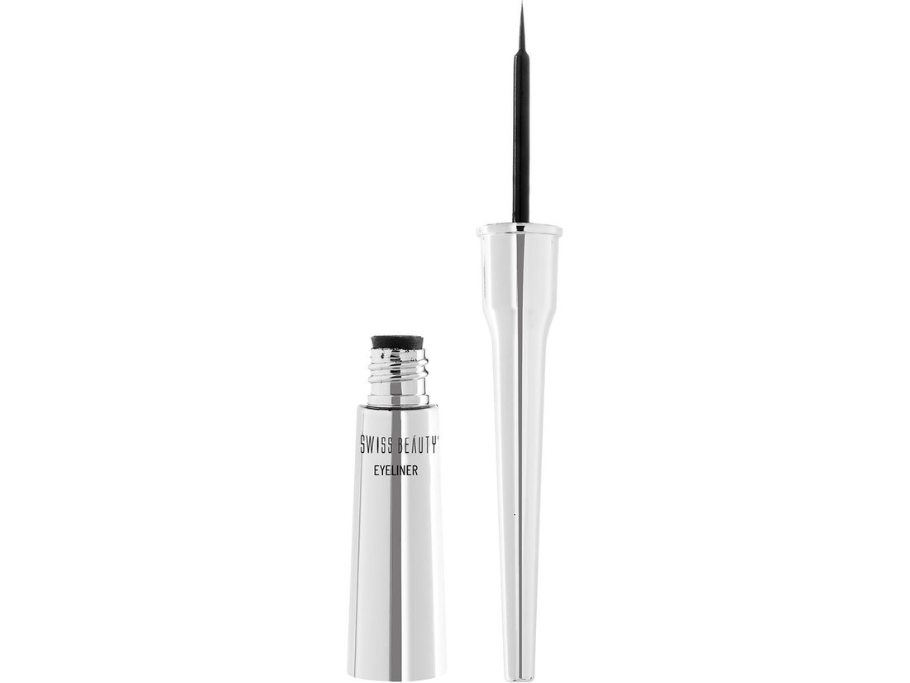 
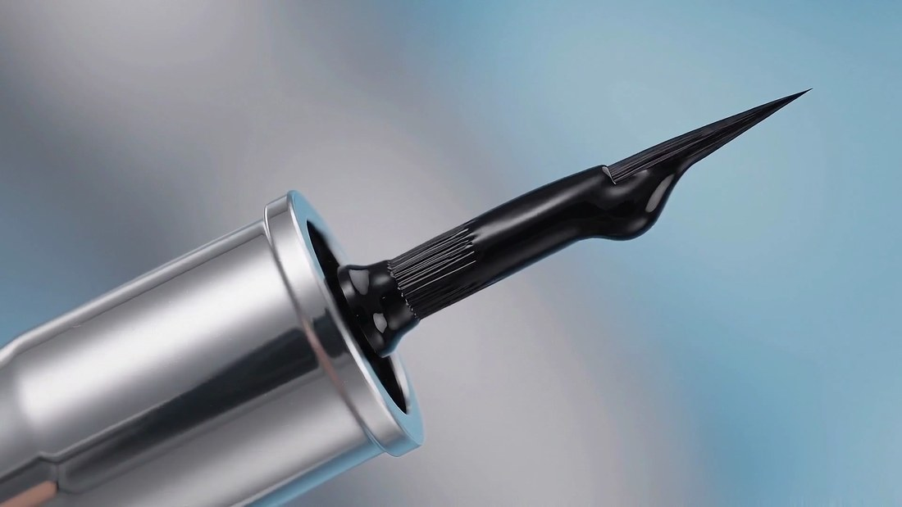 
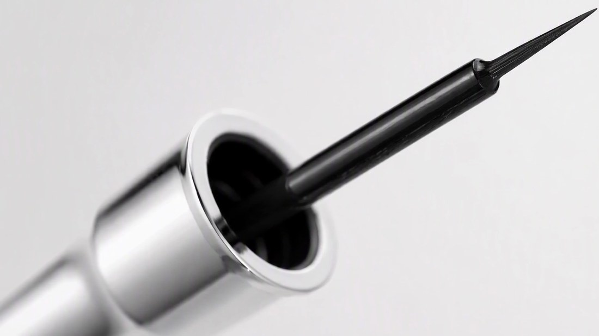 

catalog photo · before, 0:03 · after, 0:04

### g03

**Shape wrong.** Beard trimmer. The ridged length-adjustment wheel is replaced by an invented see-through battery chamber (0:07-0:11). Judge flagged, 3 of 3 reviewers marked.

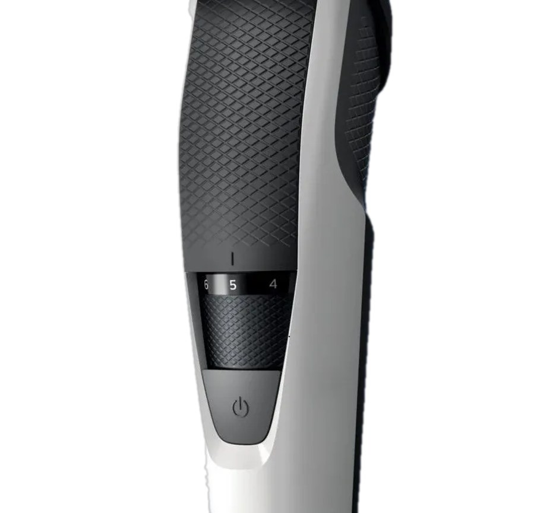 
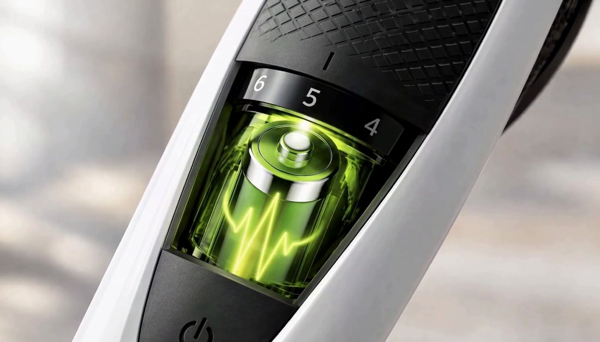 

catalog photo (crop) · frame 0:08

[clip](https://d2xx1th8aoijk.cloudfront.net/assets/local_ads_studio/lacomp_97de557f7251/scene_2_motion-ce873ea2c6dc.mp4)

### g04

**Color wrong.** Smartwatch. The strap buckle is bright silver, where the real watch's is dark blue (0:00-0:01); judge flagged, 1 of 1 reviewer marked.

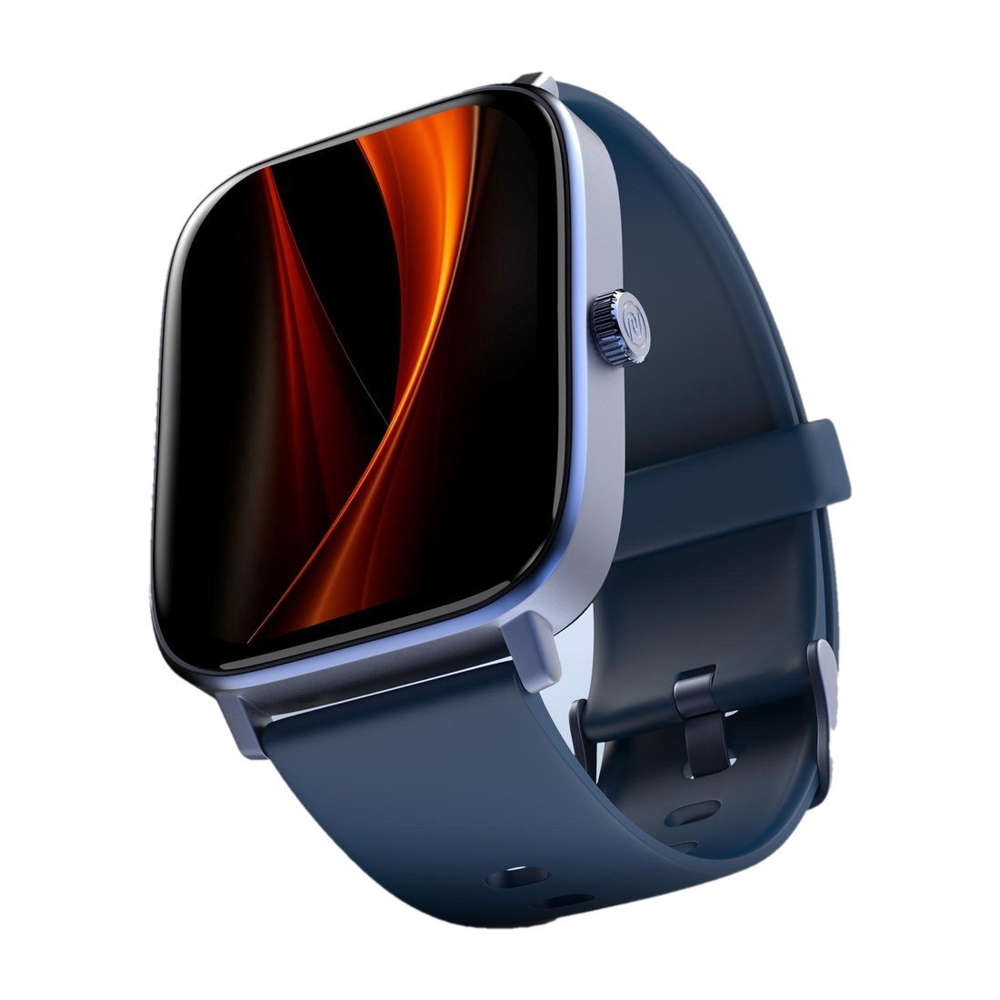 
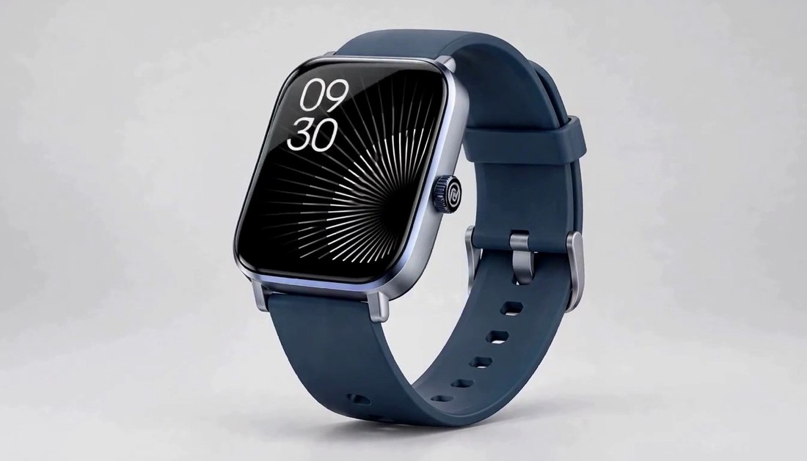 

catalog photo · frame 0:00

[clip](https://d2xx1th8aoijk.cloudfront.net/assets/local_ads_studio/lacomp_4a49c3852347/scene_0_motion-1fb2a36ed900.mp4)

### g06

**Text slightly garbled (low), Repair at higher resolution.** Inkjet printer. Before: the model name and the small print under it, PRINT FAX SCAN COPY WEB in the catalog photo, are smeared but readable (0:05); judge flagged, 1 of 1 reviewer marked. After: Repair re-rendered the scene from its original inputs at higher resolution, and both lines read correctly; this pair is from our repair study and is judged here by eye only.

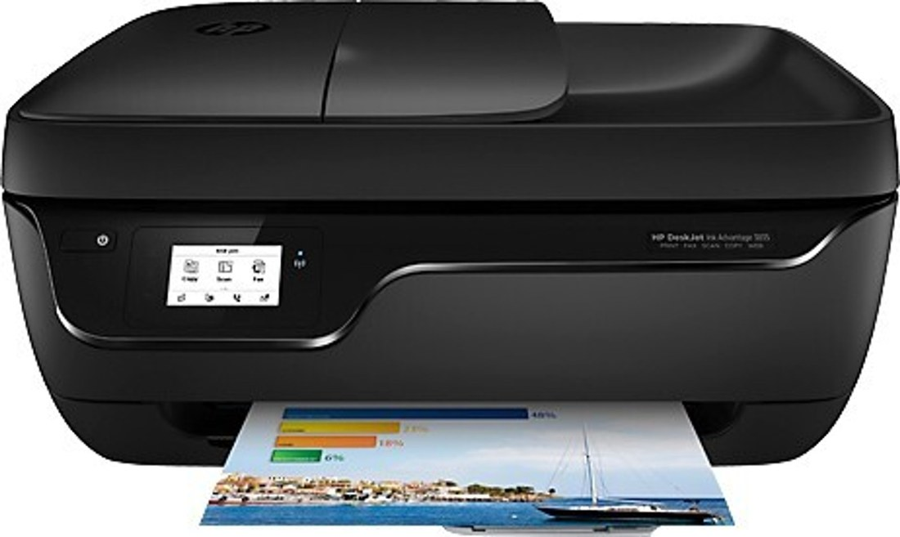 
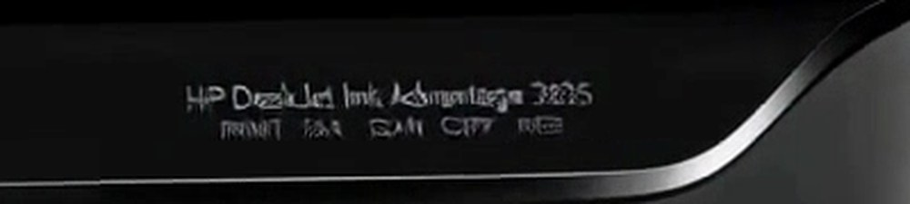 
 

catalog photo · before, 0:05 (crop) · after, Repair (crop)

### g07

**Text gibberish, color drift.** Water purifier. The service badge turns into non-words with a wrong phone number, and the body starts white before turning black like the real unit (0:04-0:09). Judge flagged both, 3 of 3 reviewers marked both.

 
 
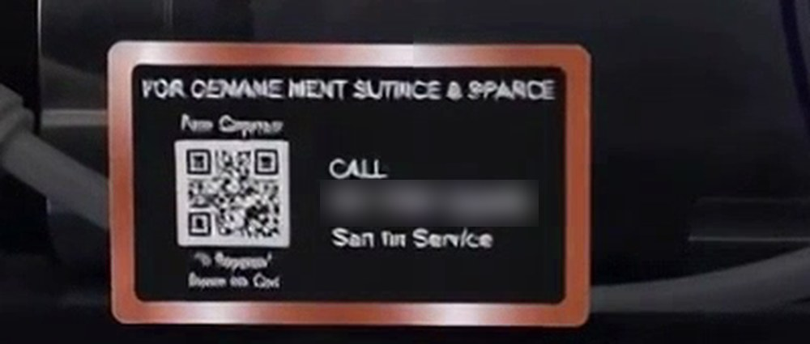 

catalog photo · frame 0:04 (white body; number blurred) · frame 0:07, service badge (crop; number blurred)

[clip](https://d2xx1th8aoijk.cloudfront.net/assets/local_ads_studio/lacomp_d0c5b7f1dde6/scene_1_motion-0215d5d14677.mp4)

### g08

**Garbled label, Repair at higher resolution.** Body lotion. Before: the claim lines on the lower label are smeared (0:11); judge flagged, 3 of 3 reviewers marked. After: Repair regenerated the clip itself at higher resolution, guided by its own prompt and references, and the lines read correctly; graded by four blind model graders only.

 
 
 

catalog photo (crop) · before, 0:11 (crop) · after, Repair (crop)

### g05

**AI issue on the product.** Suitcase, last scene (0:09-0:15). Two pairs of spinner wheels stick out of the case right beside the combination lock; on the real case the lock sits high on the side seam and the wheels are only at the four bottom corners. The scene judge flagged it as an AI issue but the product judge passed it; 1 of 1 reviewer marked the product wrong in an early pilot round.

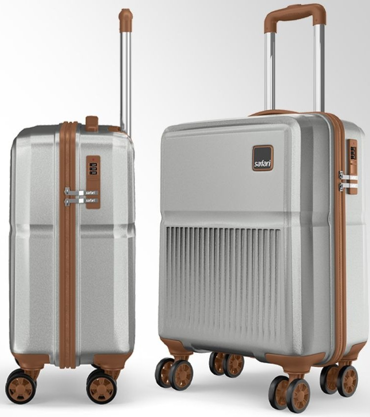 
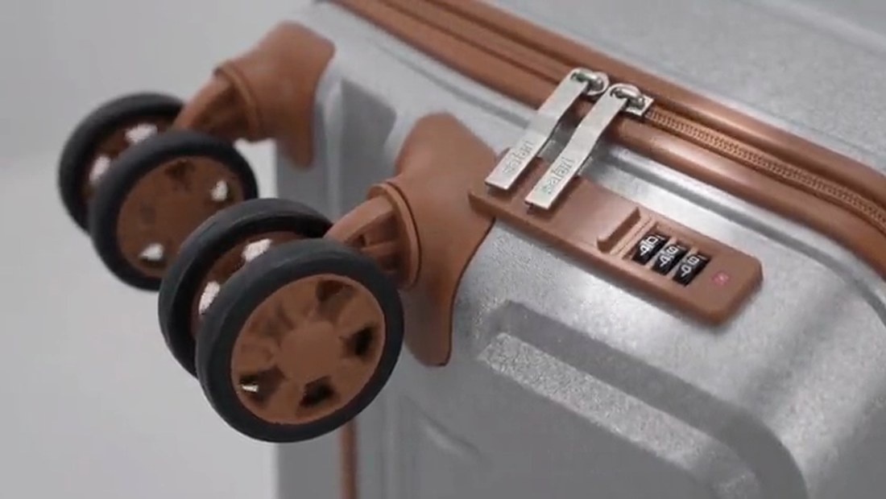 

catalog photo (crop) · frame 0:12

## Scene quality

### g13

**Good scene (Keep).** Kurta set, a good scene for contrast: the camera starts wide on the outfit and pushes in on the print and hem while a caption names the cut (0:06-0:09). The reviewer guide uses it as a Keep example (1 pilot reader marked Keep); the scene judge raised no finding on it.

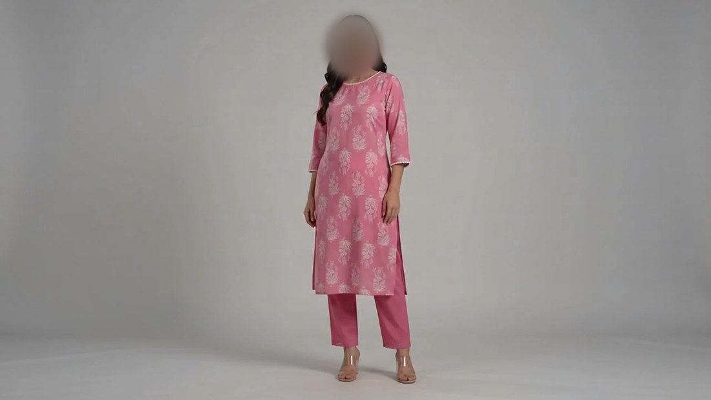 
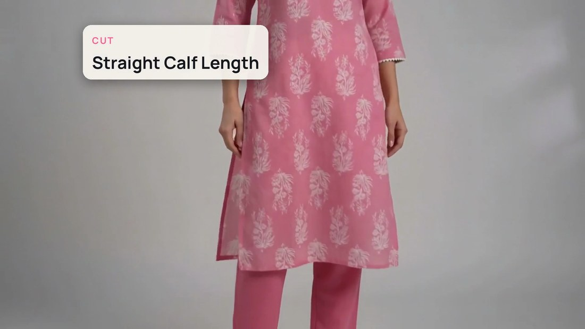 

frame 0:06.3 (start, wide) · frame 0:08.6 (end of the push-in)

### g14

**Ghost copies overlap.** Wristwatch, strap close-up. Half a second into the scene, as the camera changes angle, several translucent copies of the watch face and buckle overlap, then settle into one strap (about 0:09). Judge flagged (frames judge accepted 3/3, clip judge 2/3); 3 of 3 reviewers marked swap (AI issue).

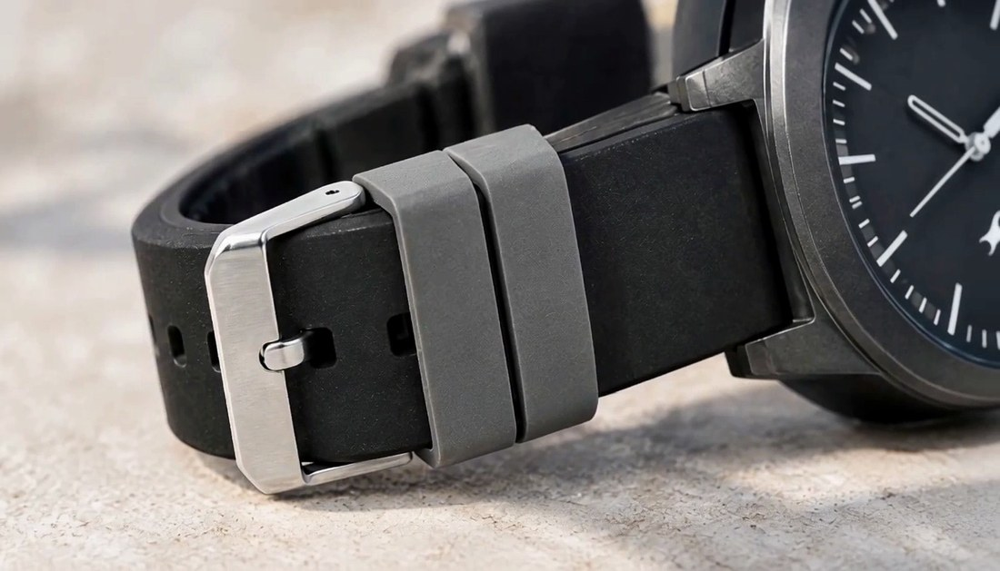 
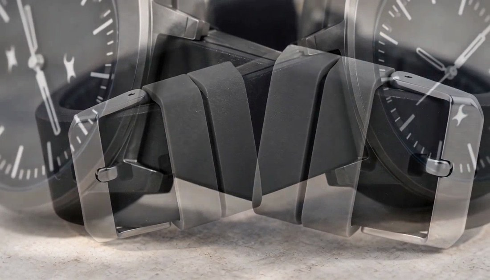 

frame 0:08.4 (just before) · frame 0:09.0 (copies overlap)

[clip](https://d2xx1th8aoijk.cloudfront.net/assets/local_ads_studio/lacomp_69c84bc8d3b7/scene_2_motion-f408f968144e.mp4)

### g15

**Crowded frame.** Air conditioner. A cluster of duplicated indoor units and an oversized copper coil fill the frame, and then the coil fills most of the frame, so the product is hard to read (0:03-0:07). Judge flagged (accepted 3/3); 3 of 3 reviewers marked swap (repetitive, dull or crowded).

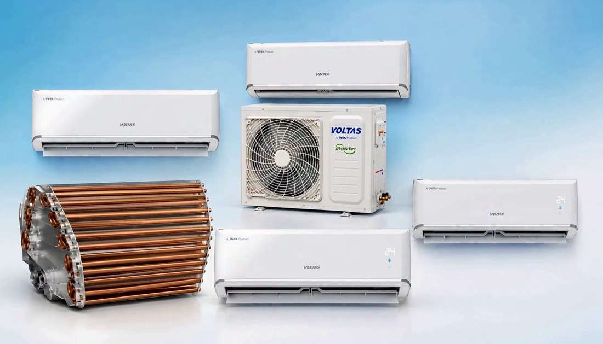 
 

frame 0:03.4 · frame 0:05.6

[clip](https://d2xx1th8aoijk.cloudfront.net/assets/local_ads_studio/lacomp_90aaf2d43d6a/scene_1_motion-9b8833fc854a.mp4)

### g16

**Repeats the opening.** Backpack. The closing scene repeats the opening scene: the same front-on framing and the same push-in to the printed panel (0:00-0:04 and 0:11-0:15). Both scene judges flagged it (each accepted 3/3); 3 of 3 reviewers marked the closing scene swap (repetitive, dull or crowded).

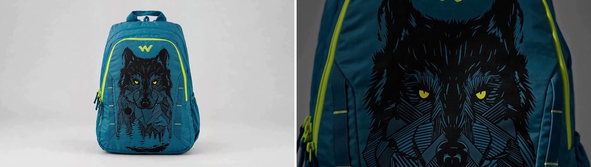 
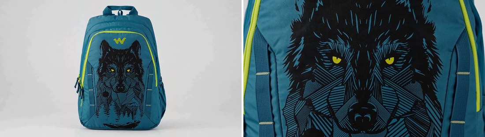 

opening scene: frames 0:00.2 and 0:03.7 · closing scene: frames 0:11.7 and 0:15.0

[clip](https://d2xx1th8aoijk.cloudfront.net/assets/local_ads_studio/lacomp_64da80ce8ca2/scene_3_motion-4a6749b7c46d.mp4)

### g17

**Set changes mid-ad.** Suitcase ad from a production run. Scenes 1 to 3 sit on a cream studio background; at 0:09.4 scene 4 cuts to a dark set, and the last scene goes back to cream. Judge flagged (accepted 1/1); 1 of 1 reviewer marked swap (world or continuity breaks).

 
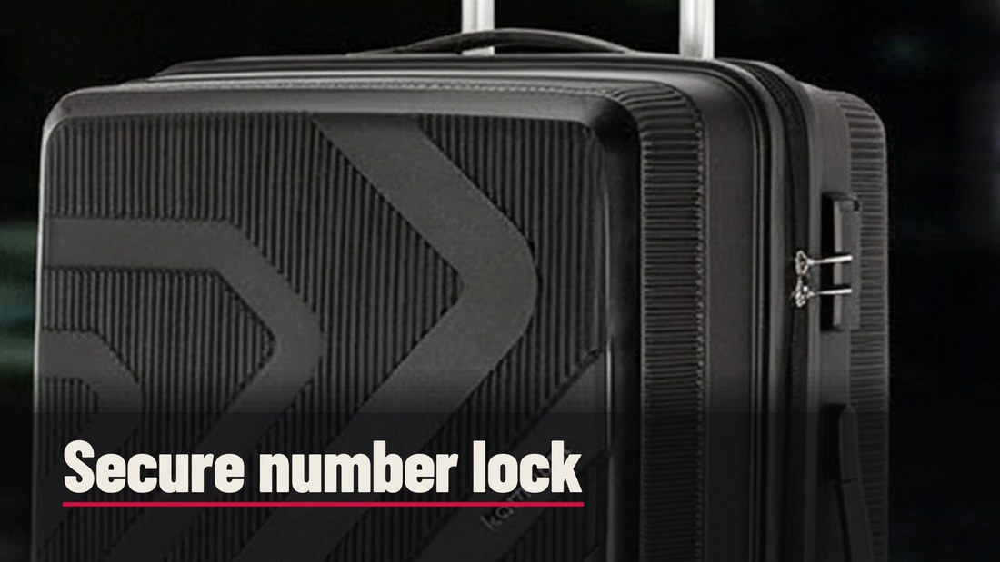 

frame 0:02.3 (scene 2) · frame 0:10.2 (scene 4)

### g18

**Units multiply.** Air conditioner, closing scene. One indoor unit becomes four, plus an outdoor unit and a copper coil: they fade in from nowhere and drift into place (0:12.4-0:15). Clip judge flagged (accepted 3/3; frames judge 2/3); 3 of 3 reviewers marked swap (impossible motion).

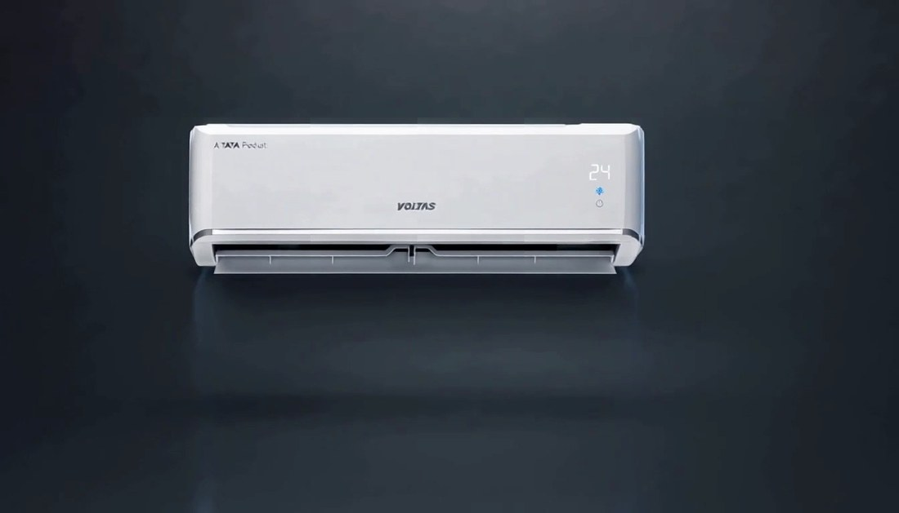 
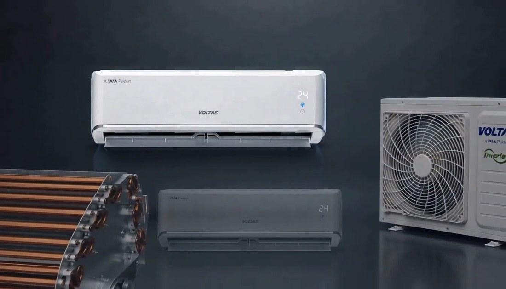 
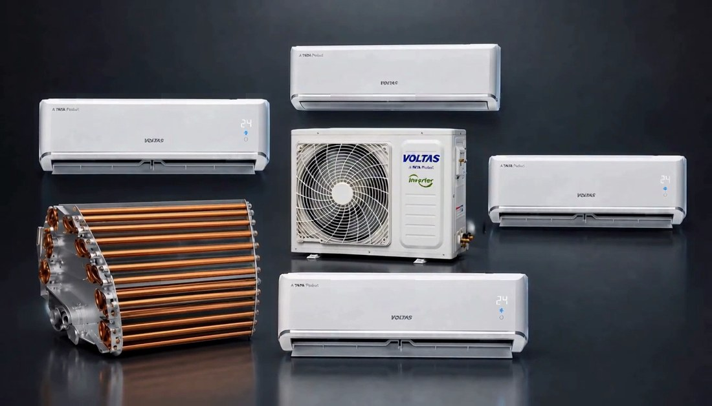 

frame 0:12.6 · frame 0:12.8 · frame 0:15.0 (end)

[clip](https://d2xx1th8aoijk.cloudfront.net/assets/local_ads_studio/lacomp_b06f274b8a18/scene_4_motion-c3282d307afe.mp4)

### g19

**Shoe floats through model.** Sports shoe, opening scene. A giant translucent shoe fades in over the model and ends up floating in front of him, passing through his body (0:00.5-0:01.5). Both scene judges flagged it (each accepted 3/3); 3 of 3 reviewers marked swap (impossible motion).

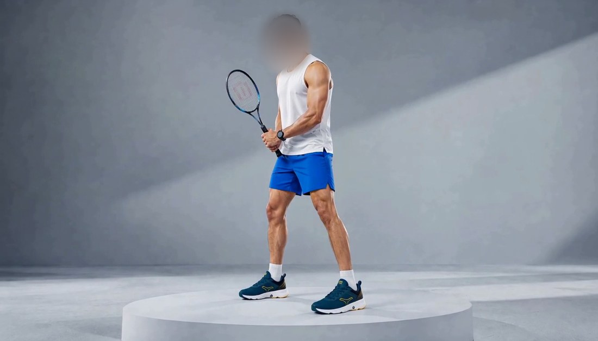 
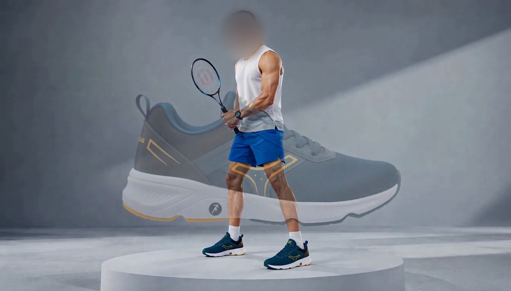 
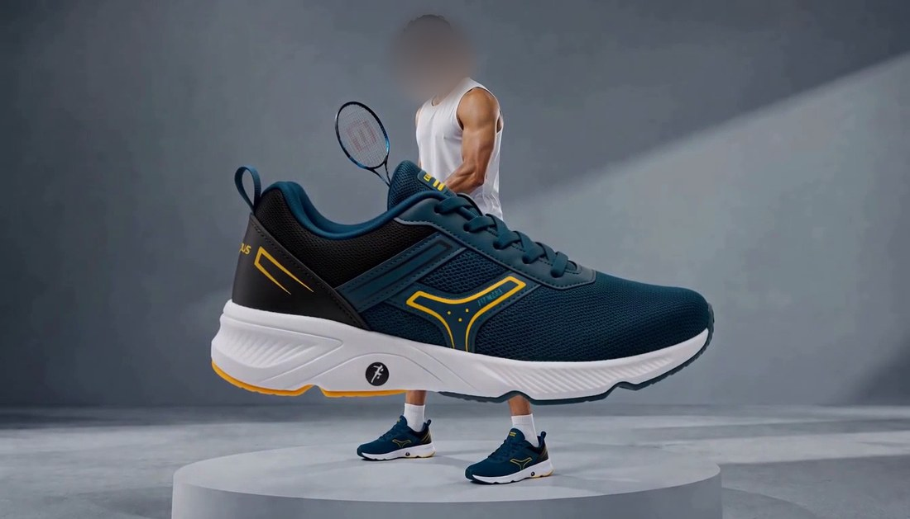 

frame 0:00.5 · frame 0:00.9 · frame 0:01.4

[clip](https://d2xx1th8aoijk.cloudfront.net/assets/local_ads_studio/lacomp_f5ece1330e9c/scene_0_motion-044f8f90d4f8.mp4)

### g20

**Ends on a tight crop.** Water purifier, closing scene. The scene opens on the front of the purifier, then pushes in until the ad ends on a tight crop of the tap (last frame 0:14.9). Both scene judges flagged it (each accepted 3/3); 3 of 3 reviewers marked swap (weak ending).

 
 

frame 0:13.0 · frame 0:14.9 (last frame)

[clip](https://d2xx1th8aoijk.cloudfront.net/assets/local_ads_studio/lacomp_3fa9fd1eafda/scene_4_motion-42c300926fd0.mp4)

## Pronunciation, script, sound and captions

### g22

**Word said wrong.** Kurta set, scene 2 of 4: the on-screen card reads 'Boat Neck', but the narrator says 'bolt neck'. 1 reviewer marked it in an early pilot round; no judge result is recorded for it.

 
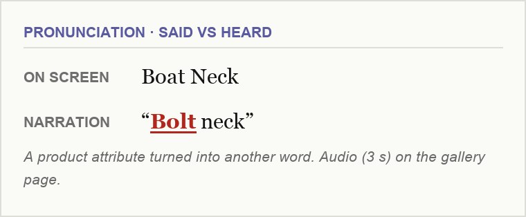 

frame, scene 2 (caption card) · said vs heard

[audio](audio/g22.mp3)

### g23

**Respelled, re-voiced.** Trousers ad, line 'Straight fit, ready to wear.': the speech judge heard 'Street fit'. After the word was respelled STRAYT in the voice prompt and only that line was re-voiced, it heard 'Straight fit'. Only the speech judge checked the two takes; no person did. Control: a plain second take with no respelling turned 'Mate from' into 'Made from' on another line, and across the whole test respelling fixed about as many flagged lines as a plain second take (27% vs 25%).

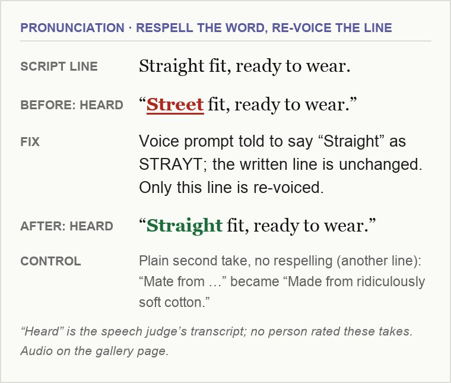 

said vs heard, before/after

[audio](audio/g23.mp3) · [audio, control](audio/g23_control.mp3)

### g24

**Claim not in the source.** Suitcase ad, 0:00-0:04: the narration says the shell is 'unbreakable', but the product record only calls it scratch-resistant and tough. The script judge flagged it, and all 3 reviewers marked it by accepting that finding, so the marks are not independent of the judge.

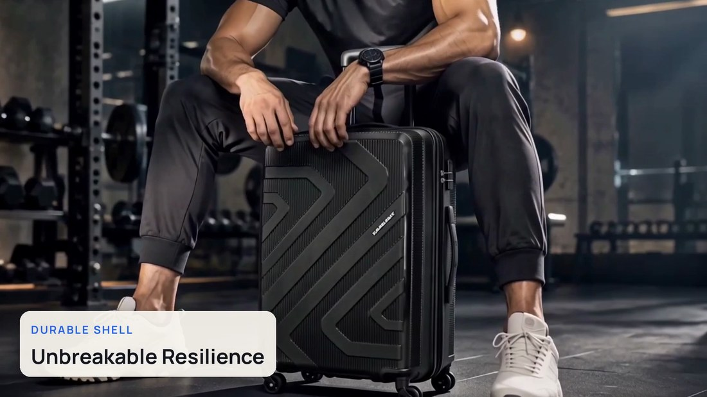 
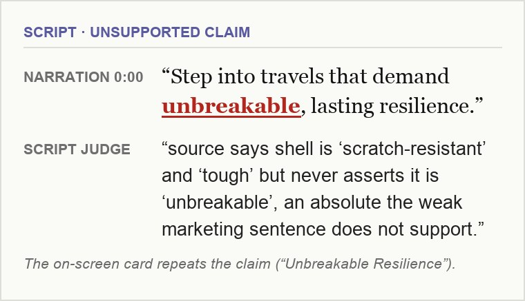 

frame 0:01.5 · line and judge finding

[audio](audio/g24.mp3) · [clip](https://d2xx1th8aoijk.cloudfront.net/assets/videos/product-promo-attempts/vid_9aeebf226dbe/lagen_1ee07f6393/fb8afb94442442e28d8927322cc5ff08.mp4)

### g25

**Number without its unit.** Smartphone ad from a production review outside the round, 0:06: the line 'Power through with a 5000 battery.' drops the unit (mAh), so it sounds like a spec-sheet field. The script judge flagged it, and so did a second script judge that this review also ran and that was later dropped (each finding got 1 thumbs-up and none down). Both reviewers marked awkward phrasing: one on this line, one for the ad as a whole.

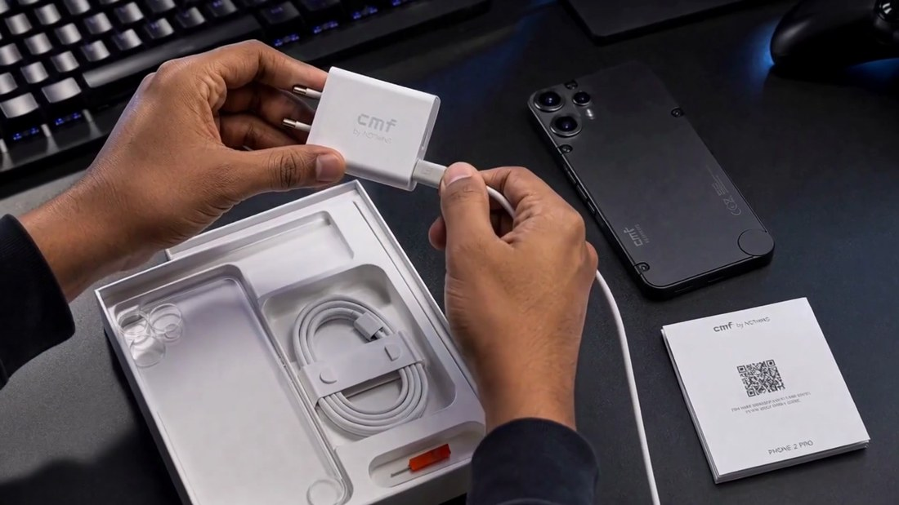 
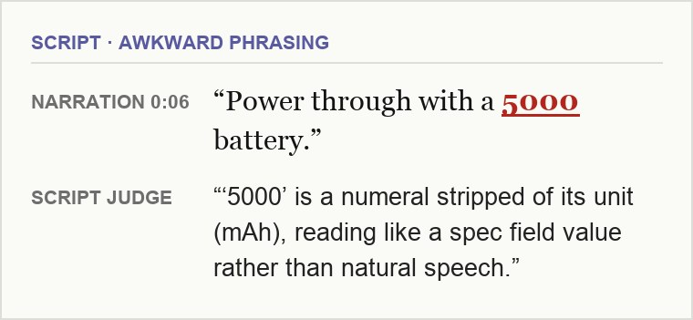 

frame 0:07 · line and judge finding

[audio](audio/g25.mp3)

### g27

**Claim narrowed.** Earbuds ad from the 410-ad script-rewrite test of Sec. 5: 'The [brand] block it all with intelligent AI noise cancellation.' claims more than the listing, which only says they block background noise on calls and filter out background noise. Only that line was rewritten at generation time, as 'The [brand] block background noise on calls.' The script judge flagged the old line and passed the new one on its first re-read, and a separate model check agreed. The script is one of the 129 the annotators then read cold, and no annotator flagged it.

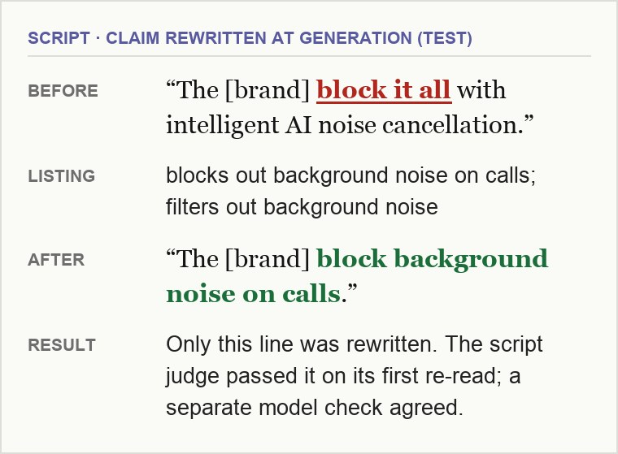 

before/after (text)

### g28

**Wrong accent.** Skincare lotion ad from a production run before the round, whole narration (0:00-0:13): the ad was meant for the Indian market, but the narrator did not have the right accent. The sound judge flagged it (in the round it flagged no ad, Sec. 6), and both reviewers marked the whole voice as off after accepting its finding.

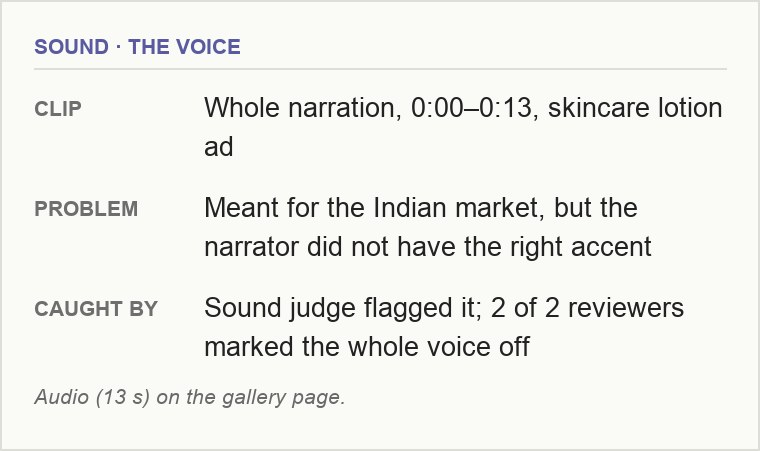 

sound judge and marks (text)

[audio](audio/g28.mp3)

### g29

**Voice swapped.** Eyeliner ad from a production run, whole narration: the run's one reviewer marked the whole voice off, and a Quick fix in the review editor swapped in a different stock voice, keeping the same script and music. This is a plain voice swap, separate from the speech-to-speech re-voicing of Tab. 3. No judge flagged the voice, and no model or person judged the new render. The new render also has an earlier scene-2 remake, so compare the audio only.

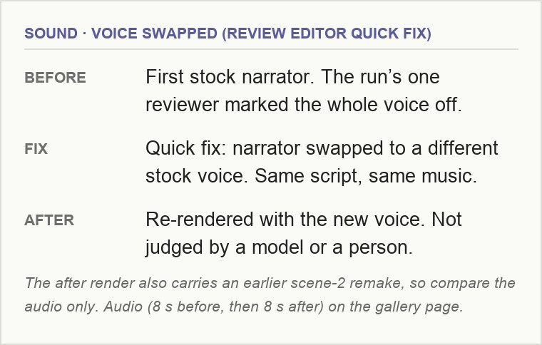 

before/after (text)

[audio](audio/g29.mp3)

### g30

**Card over the wheel.** Suitcase ad, 0:00-0:04: the caption sits on the wheel and bottom corner of the suitcase even though the frame has empty space around it. 3 of 3 reviewers marked placement; a placement judge, run after the round and never shown to reviewers, flagged it in both of its runs.

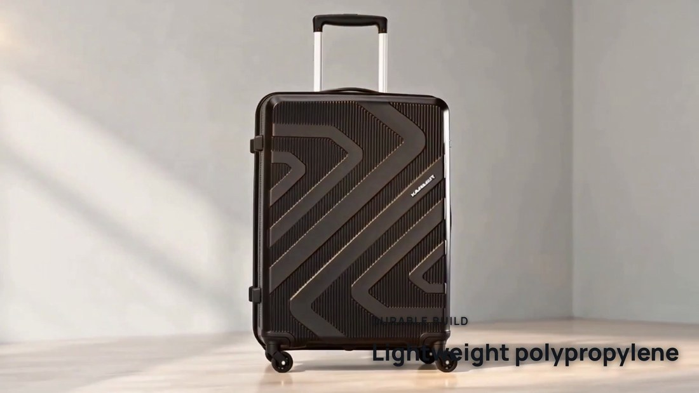 

frame 0:02

[clip](https://d2xx1th8aoijk.cloudfront.net/assets/videos/product-promo-attempts/vid_8803f38b0515/lagen_1ee07f6393/0df6b2397542478da7fc2cbc01e0b975.mp4)

### g31

**Card over a face.** Face serum ad, 0:10-0:12: the callout card sits on the model's forehead (face blurred here, card left as rendered). 2 of 3 reviewers marked placement; the placement judge, run after the round and never shown to reviewers, flagged it in both of its runs.

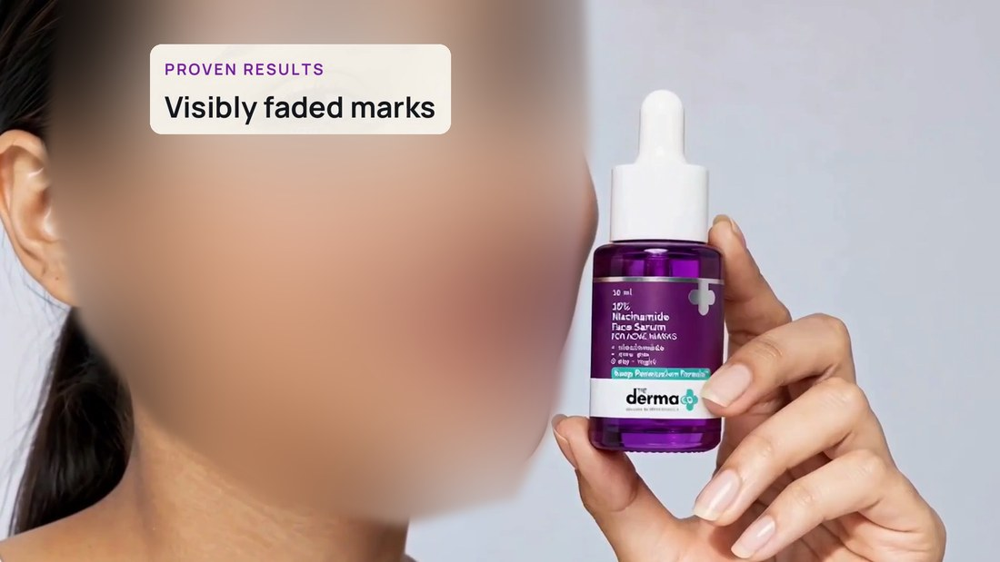 

frame 0:11 (face blurred)

[clip](https://d2xx1th8aoijk.cloudfront.net/assets/videos/product-promo-attempts/vid_800c8f9818cd/lagen_7162c15c78/ea6c9f8f7faf4cc1bdf871395b2a3fb9.mp4)

### g32

**Caption about a hidden part.** Sports shoe ad, 0:12-0:15: the card reads 'Outsole: Reliable traction', but the shoes stand flat and the sole's tread is never shown. 2 of 3 reviewers marked relevance; the relevance judge, run after the round and never shown to reviewers, flagged it in both of its runs.

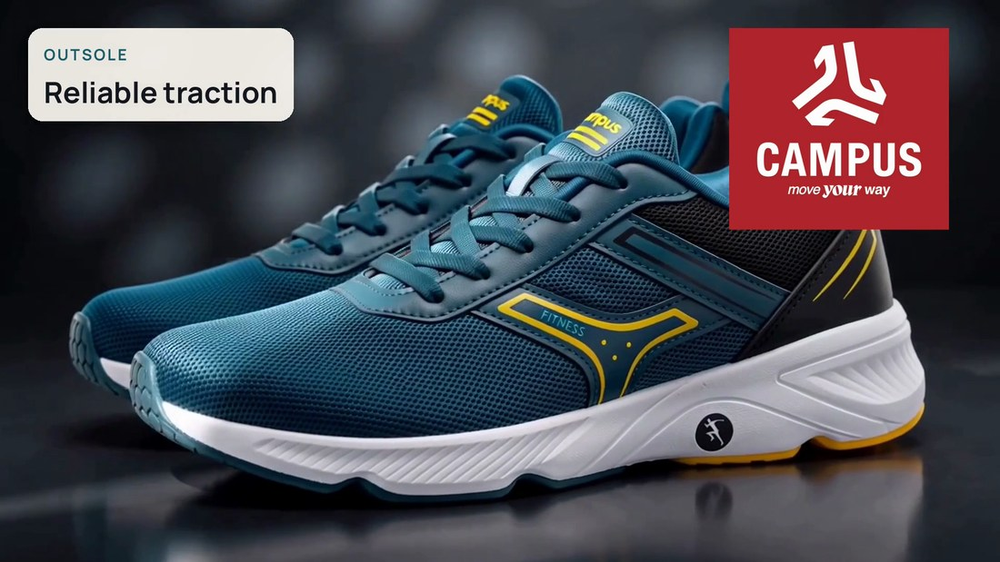 

frame 0:13

[clip](https://d2xx1th8aoijk.cloudfront.net/assets/videos/product-promo-attempts/vid_10c023208848/lagen_aaa0fff954/fc4874fd849141ddac2bad7e3fb7d421.mp4)

### g33

**Overlay restyled (unshipped prototype).** Router ad, 0:12: the delivered caption is near-black text on a navy background and cannot be read. Restyling only the caption layer put the same words on a cream card without touching the video. This is an unshipped prototype, and only the project owner looked at the after. Reviewers are not asked about readability, but 2 of 3 marked this caption's placement; the placement judge passed it in both runs.

 
 

before: as delivered, 0:12 · after: prototype restyle (never shipped)

